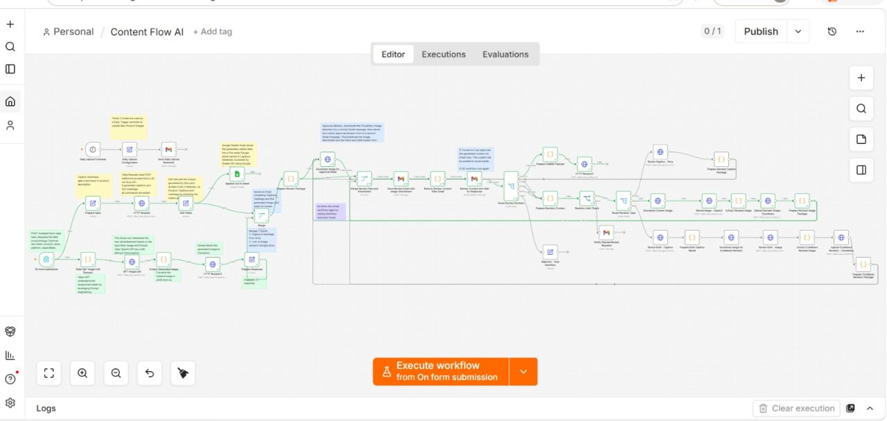

# Social Media Automation Workflow (Content Flow AI)

An [n8n](https://n8n.io) workflow that creates social media ad content with AI. It writes captions and hashtags, generates ad images, saves everything to Google Sheets and Google Drive, and emails a human reviewer to approve or reject each ad before it's posted.

## What it does

| Stage | Nodes | What happens |
|---|---|---|
| **Caption generator** | Prepare Input → HTTP Request (Groq) → Edit Fields → Append row in sheet | Sends the product description to Groq (`llama-3.1-8b-instant`), which writes an Instagram caption and 10–15 SEO hashtags. The reply is split into `product`, `caption` and `hashtags` and saved as a new row in Google Sheets. |
| **Text-to-image ads** | Edit Fields1 → HTTP Request1 (Pollinations) → Upload file | Builds an image prompt and generates a luxury-style ad image with Pollinations (free). The image is saved to a Google Drive folder. |
| **Image-to-image ads** | On form submission → GPT Image Edit → Extract Generated Image | A form takes a raw product photo plus product details. OpenAI `gpt-image-1` turns the photo into a polished ad, and a Code node converts the base64 result into an image file. |
| **Human approval** | Merge → Send message and wait for response (Gmail) → If | Emails the caption, hashtags and Drive image link to a reviewer, who clicks Approve or Decline. |
| **Regeneration** | Rejected → Call sub-workflow | If the reviewer declines, the workflow records the rejection, increments `retry_count` and calls a sub-workflow to regenerate the ad. |

## Tech stack

- **n8n**: workflow automation
- **Groq API** (Llama 3.1): captions and hashtags
- **OpenAI gpt-image-1**: image-to-image ad generation
- **Pollinations**: free text-to-image generation
- **Google Sheets / Google Drive**: storage
- **Gmail**: human-in-the-loop approval

## Setup

1. In n8n, create a new workflow, open the **⋯** menu, choose **Import from File**, and select [`workflow/content-flow-ai.json`](workflow/content-flow-ai.json).
2. Create these credentials in n8n and select them on the matching nodes:
   - Groq API → **HTTP Request**
   - Google Sheets OAuth2 → **Append row in sheet**
   - Google Drive OAuth2 → **Upload file**
   - Gmail OAuth2 → **Send message and wait for response**
3. Replace the placeholders:

   | Placeholder | Node |
   |---|---|
   | `YOUR_GOOGLE_SHEET_ID` | Append row in sheet |
   | `YOUR_GOOGLE_DRIVE_FOLDER_ID` | Upload file |
   | `YOUR_OPENAI_API_KEY` | GPT Image Edit (Authorization header) |
   | `YOUR_REVIEWER_EMAIL@example.com` | Send message and wait for response |
   | `YOUR_SUBWORKFLOW_ID` | Call 'Gemini Product Ad Image Edit…' |

4. Create a Google Sheet with the columns `product`, `caption` and `hashtags`.
5. Edit the product text in **Prepare Input** and **Edit Fields1**, then run the workflow.

> Never commit real API keys. For the OpenAI key, a Header Auth credential is safer than pasting the key into the node.

## Notes

- Pollinations is free, but its images aren't always good enough to post. The OpenAI branch gives better results but needs a paid API key.
- The JSON in this repo is a cleaned-up export, so some node connections may need checking against the screenshot after you import it.
