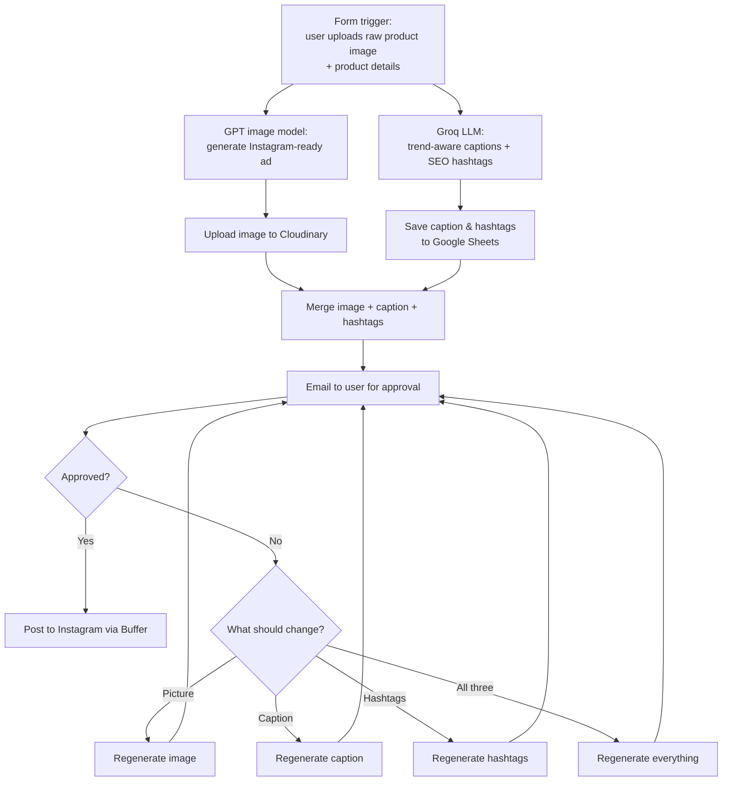

# Social Media Automation Workflow (Content Flow AI)

An end-to-end [n8n](https://n8n.io) workflow that turns a **raw product photo** into a ready-to-post **Instagram ad**. AI generates the ad image, caption and hashtags, a person approves the result by email, and the post is published automatically through **Buffer**.


## How it works



### 1. Trigger: raw image upload
The workflow starts from an **n8n Form trigger**. The user uploads a raw photo of their product (`.jpg`, `.png` or `.webp`) and enters product details such as the product name, style, platform and aspect ratio.

### 2. Ad image generation (OpenAI GPT image model)
The raw photo is sent to OpenAI's image model (`gpt-image-1`, through the `/v1/images/edits` endpoint). It returns a polished advertisement suitable for Instagram that keeps the product clear and adds a premium background. A Code node converts the base64 response into an image file.

### 3. Cloud storage (Cloudinary)
The generated ad is uploaded to **Cloudinary**, which gives it a public URL for review and posting.

### 4. Captions and hashtags (Groq)
**Groq** (Llama 3.1) writes an Instagram caption and 10–15 SEO hashtags for the product. The prompt asks it to use **trend analysis** so the content matches what's currently performing for that kind of product.

### 5. Storage (Google Sheets)
The product, caption and hashtags are saved as a row in Google Sheets. This keeps a history of all generated content.

### 6. Merge and approval email (Gmail)
The image link, caption and hashtags are merged into one package and emailed to the user with **Approve / Decline** buttons (Gmail "send and wait for response").

### 7. Publish (Buffer to Instagram)
If the user approves, the content is posted to **Instagram through Buffer**.

### 8. Targeted regeneration
If the user declines, the workflow asks **what to change**. Each option has its own pipeline:

| Choice | What gets regenerated |
|---|---|
| Picture | The ad image only (GPT, then Cloudinary) |
| Caption | The caption only (Groq) |
| Hashtags | The hashtags only (Groq) |
| All three | Image, caption and hashtags |

The revised content goes back to the user for approval. The loop repeats until the user approves, and the approved content is then posted.

## Tech stack

| Purpose | Tool |
|---|---|
| Automation | n8n |
| Ad image generation | OpenAI GPT image model (`gpt-image-1`) |
| Image hosting | Cloudinary |
| Captions and hashtags | Groq API (Llama 3.1) |
| Content log | Google Sheets |
| Human approval | Gmail |
| Publishing | Buffer to Instagram |

## Setup

1. In n8n, open the **⋯** menu, choose **Import from File**, and select the JSON in [`workflow/`](workflow/).
2. Create these credentials in n8n and select them on the matching nodes:
   - OpenAI API key (Header Auth: `Authorization: Bearer <key>`)
   - Cloudinary (cloud name and upload preset or API key)
   - Groq API
   - Google Sheets OAuth2
   - Gmail OAuth2
   - Buffer access token, with your Instagram profile connected in Buffer
3. Replace the placeholders in the workflow:

   | Placeholder | Where |
   |---|---|
   | `YOUR_OPENAI_API_KEY` | GPT Image Edit (Authorization header) |
   | `YOUR_GOOGLE_SHEET_ID` | Append row in sheet |
   | `YOUR_REVIEWER_EMAIL@example.com` | Approval email node |
   | `YOUR_GOOGLE_DRIVE_FOLDER_ID` / `YOUR_SUBWORKFLOW_ID` | Legacy nodes, if used |

4. Create a Google Sheet with the columns `product`, `caption` and `hashtags`.
5. Activate the workflow and open the form URL to submit a product image.

> Never commit real API keys. Keep them in n8n credentials instead of pasting them into nodes.

## Repository contents

```
workflow/content-flow-ai.json   n8n workflow export
images/workflow-overview.jpg    screenshot of the full workflow in n8n
README.md
```

> **Note:** the JSON currently in `workflow/` is an earlier partial export. It covers the form trigger, GPT image edit, Groq captions, Google Sheets and the approval email, and still contains an older Pollinations/Google Drive test branch. The Cloudinary, Buffer and targeted-regeneration nodes shown in the screenshot will be added with the next full export.
